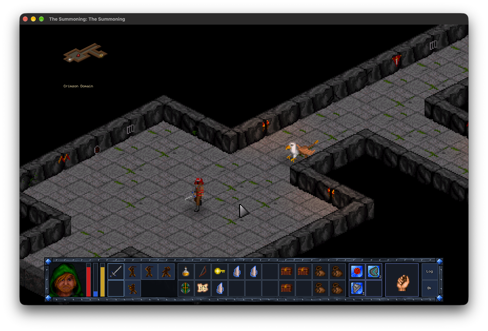

# the-summoning-go

A Go engine on [Ebitengine](https://ebitengine.org) for isometric, real-time, grid-based fantasy
RPGs in the style of *The Summoning* (Event Horizon Software, 1992): a dungeon seen at an isometric
angle, palette pixel art, a character panel, real-time combat and spellcasting, conversation by
keyword, and levels full of pressure plates, levers, keyholes, teleporters and objects to move.



The engine is general, and *The Summoning* is its first game. An importer turns your own copy of
the game's data files into a content pack the engine plays: levels, creatures, items, text, art and
music. **No original game data is in this repository.** You need your own copy of the game.

This is a work in progress. [docs/design-notes.md](docs/design-notes.md) records what is done and
what remains.

## Requirements

- Go 1.27 or later
- What Ebitengine needs on your platform (on Linux, the X11/OpenGL development packages); see
  Ebitengine's [install guide](https://ebitengine.org/en/documents/install.html)

## Build

```sh
go build -o summoning .
```

## Play The Summoning

Point the importer at the directory that holds your copy of the game's data files. It writes a pack
to `packs/summoning`, which stays on your machine. Don't share it, because it contains the game's
art and data.

```sh
./summoning import /path/to/summoning   # add --no-audio for a faster import
./summoning play packs/summoning
```

`summoning play --help` lists the keys. They follow the original game's layout.

To carry on a game saved in the original:

```sh
./summoning import-save /path/to/summoning /path/to/summoning/SAVES/d001.sav
```

## Without the game

The dev pack is built by code, using plain drawn art and small levels that lay out each of the
engine's mechanisms. It needs no game data:

```sh
./summoning devpack
./summoning view packs/dev    # look around and work the mechanisms
./summoning play packs/dev
```

## Commands

| Command | Does |
| --- | --- |
| `import` | Converts the game's data files into a content pack |
| `import-save` | Converts the game's saved games into engine saves |
| `play` | Plays a pack |
| `view` | Opens a pack's levels with tools to inspect cells and things and run mechanisms |
| `devpack` | Writes the dev pack |
| `flipbook` | Plays a pack's animated effects |

Each takes `--help`.

## Documentation

- [docs/spec/](docs/spec/README.md): the specification of *The Summoning*, covering what the game
  does and how its data files are laid out. The engine's rules and the importer are built from it.
- [docs/design.md](docs/design.md): the engine's design.
- [docs/pack.md](docs/pack.md): the content pack format, for making your own games and mods.

## Development

```sh
gofmt -l .
go vet ./...
go test ./...
```

The tests use small hand-made fixtures and need neither the game nor a display. Tests that check the
importer against real game files run only when `SUMMONING_DATA` (the data directory) or
`SUMMONING_SAVES` (a saves directory) is set. Otherwise they are skipped.

[AGENTS.md](AGENTS.md) has the project's rules. The most important one is that the spec is the
source of truth: a behavior change goes into `docs/spec/` first, then into the code.

## License

MIT; see [LICENSE](LICENSE). *The Summoning* and its data are the property of their owners. This
project is not affiliated with them.
